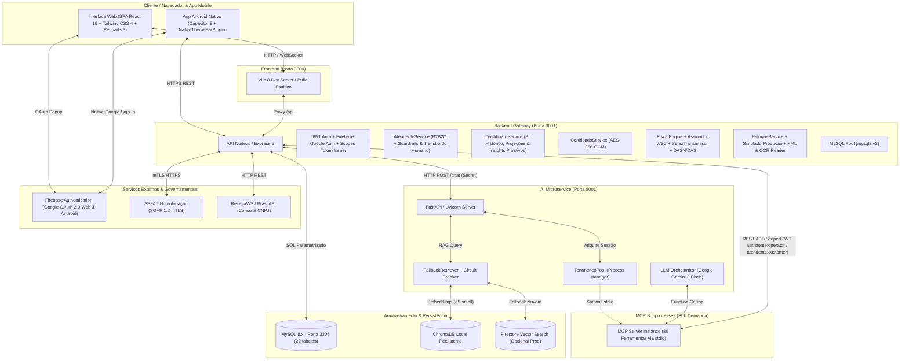

# MEI — Gestão Simplificada para Microempreendedores Individuais

> **Projeto Final • Formação Recode Pro AI**  
> Plataforma integrada de gestão operacional, produtiva, fiscal, analítica (BI) e financeira para Microempreendedores Individuais (MEI), potencializada por um **Assistente Virtual de Inteligência Artificial** com RAG semântico, um **Atendente Pessoal de IA para os clientes do MEI (B2B2C)** com transbordo humano, **Dashboards Customizáveis com Projeção Preditiva**, autenticação **Firebase Google OAuth** (Web e Android nativo), transmissão oficial SEFAZ via **Certificado Digital A1**, **aplicativo Android (Capacitor)**, identidade visual **"Feito à Mão"** com temas dinâmicos e Model Context Protocol (MCP) multi-tenant com paridade total de capacidades operacionais (**80 ferramentas**).

---

## 📌 Sumário
- [1. Visão Geral da Solução](#1-visão-geral-da-solução)
- [2. Topologia de Infraestrutura e Stack Tecnológica](#2-topologia-de-infraestrutura-e-stack-tecnológica)
- [3. Arquitetura do Microserviço de IA & Sistema RAG](#3-arquitetura-do-microserviço-de-ia--sistema-rag)
  - [3.1 Orquestração LLM & Gemini (Processamento Assíncrono)](#31-orquestração-llm--gemini-processamento-assíncrono)
  - [3.2 Pipeline Completo de RAG Semântico](#32-pipeline-completo-de-rag-semântico)
  - [3.3 Corpus de Documentos Oficiais (MEI & CF88)](#33-corpus-de-documentos-oficiais-mei--cf88)
  - [3.4 Guia de Vetorização, Indexação e Consulta via CLI](#34-guia-de-vetorização-indexação-e-consulta-via-cli)
  - [3.5 Armazenamento Vetorial Híbrido & Resiliência](#35-armazenamento-vetorial-híbrido--resiliência)
  - [3.6 MCP Multi-Tenant e Catálogo de Ferramentas (80 Tools)](#36-mcp-multi-tenant-e-catálogo-de-ferramentas-80-tools)
  - [3.7 Atendente Pessoal do Cliente (B2B2C) e Transbordo Humano](#37-atendente-pessoal-do-cliente-b2b2c-e-transbordo-humano)
- [4. Módulo Fiscal e Certificado Digital A1](#4-módulo-fiscal-e-certificado-digital-a1)
  - [4.1 Tipos de Documentos Suportados](#41-tipos-de-documentos-suportados)
  - [4.2 Certificado A1 Criptografado (AES-256-GCM)](#42-certificado-a1-criptografado-aes-256-gcm)
  - [4.3 Assinatura Digital W3C XMLDSig e SOAP mTLS SEFAZ](#43-assinatura-digital-w3c-xmldsig-e-soap-mtls-sefaz)
  - [4.4 Cancelamento Homologado e Estorno no Caixa](#44-cancelamento-homologado-e-estorno-no-caixa)
- [5. Módulo de Estoque, Produção e Fichas Técnicas](#5-módulo-de-estoque-produção-e-fichas-técnicas)
  - [5.1 Gestão de Insumos e Estoque Mínimo](#51-gestão-de-insumos-e-estoque-mínimo)
  - [5.2 Fichas Técnicas, CMV e Margens de Lucro](#52-fichas-técnicas-cmv-e-margens-de-lucro)
  - [5.3 Lotes de Produção e Simulação Preditiva](#53-lotes-de-produção-e-simulação-preditiva)
  - [5.4 Importação Automática por XML de NF-e](#54-importação-automática-por-xml-de-nf-e)
- [6. Módulo de Dashboards Customizáveis e BI Preditivo](#6-módulo-de-dashboards-customizáveis-e-bi-preditivo)
  - [6.1 Múltiplos Painéis e Grid Interativo (Drag-and-Drop)](#61-múltiplos-painéis-e-grid-interativo-drag-and-drop)
  - [6.2 Catálogo de Métricas e Projeção Financeira Futura](#62-catálogo-de-métricas-e-projeção-financeira-futura)
  - [6.3 Criação de Gráficos via Assistente de IA (Paridade MCP)](#63-criação-de-gráficos-via-assistente-de-ia-paridade-mcp)
  - [6.4 Insights Proativos e Paleta Dinâmica nos Gráficos](#64-insights-proativos-e-paleta-dinâmica-nos-gráficos)
- [7. Pagamentos, Recorrência e Obrigações do MEI](#7-pagamentos-recorrência-e-obrigações-do-mei)
- [8. Identidade Visual "Feito à Mão", Temas Dinâmicos e UI Adaptativa](#8-identidade-visual-feito-à-mão-temas-dinâmicos-e-ui-adaptativa)
  - [8.1 Landing Page Pública e Mascote "Gato Empreendedor"](#81-landing-page-pública-e-mascote-gato-empreendedor)
  - [8.2 Motor de Temas Dinâmicos e Tokens CSS](#82-motor-de-temas-dinâmicos-e-tokens-css)
  - [8.3 Responsividade Mobile e Componentes Adaptativos](#83-responsividade-mobile-e-componentes-adaptativos)
- [9. Aplicativo Mobile Android (Capacitor)](#9-aplicativo-mobile-android-capacitor)
- [10. Autenticação Híbrida (JWT + Firebase Google Auth) e Segurança Multi-Tenancy](#10-autenticação-híbrida-jwt--firebase-google-auth-e-segurança-multi-tenancy)
- [11. Serviços, Portas e Variáveis de Ambiente](#11-serviços-portas-e-variáveis-de-ambiente)
- [12. Guia de Execução e Instalação Local](#12-guia-de-execução-e-instalação-local)
  - [12.1 Pré-requisitos](#121-pré-requisitos)
  - [12.2 Banco de Dados MySQL (Docker ou Nativo)](#122-banco-de-dados-mysql-docker-ou-nativo)
  - [12.3 Instalação de Dependências](#123-instalação-de-dependências)
  - [12.4 Configuração de Variáveis de Ambiente](#124-configuração-de-variáveis-de-ambiente)
  - [12.5 Migrações e Carga Inicial do Banco](#125-migrações-e-carga-inicial-do-banco)
  - [12.6 Vetorização do Corpus RAG (Indexação no ChromaDB)](#126-vetorização-do-corpus-rag-indexação-no-chromadb)
  - [12.7 Inicialização do Ambiente Integrado (Com Checagem de Portas)](#127-inicialização-do-ambiente-integrado-com-checagem-de-portas)
  - [12.8 Credenciais de Acesso de Demonstração (Multi-Tenant)](#128-credenciais-de-acesso-de-demonstração-multi-tenant)
- [13. Suíte de Testes Automatizados (843 testes)](#13-suíte-de-testes-automatizados-843-testes)
- [14. API RESTful — Endpoints Principais](#14-api-restful--endpoints-principais)
- [15. Modelo de Dados Relacional (22 tabelas)](#15-modelo-de-dados-relacional-22-tabelas)

---

## 1. Visão Geral da Solução

O **Aranduê (MEI)** unifica o fluxo comercial, produtivo, fiscal, analítico e financeiro do microempreendedor em uma única plataforma web integrada:

### Fluxo Comercial & Financeiro
$$\text{Cliente} \longrightarrow \text{Orçamento} \longrightarrow \text{Agendamento} \longrightarrow \text{Cobrança} \longrightarrow \text{Pagamento (Pix/Dinheiro)} \longrightarrow \text{Livro Caixa}$$

### Fluxo Produtivo & Estoque
$$\text{Insumos} \longrightarrow \text{Ficha Técnica (CMV)} \longrightarrow \text{Lote de Produção} \longrightarrow \text{Estoque de Produtos} \longrightarrow \text{Abate Automático na Venda}$$

### Fluxo Fiscal & SEFAZ
$$\text{Venda / Serviço} \longrightarrow \text{Criptografia AES-256} \longrightarrow \text{Assinatura W3C (Certificado A1)} \longrightarrow \text{SOAP mTLS SEFAZ / Emulador} \longrightarrow \text{DANFE com QR Code}$$

### Fluxo Analítico & BI Preditivo
$$\text{Livro Caixa + Cobranças + Agenda} \longrightarrow \text{Motor de Métricas Paralelo} \longrightarrow \text{Projeção Futura e Alertas de Teto MEI} \longrightarrow \text{Widgets Recharts Drag-and-Drop}$$

### Fluxo de Atendimento ao Cliente Final (B2B2C)
$$\text{Cliente do MEI (link público)} \longrightarrow \text{Atendente IA} \longrightarrow \text{Catálogo, Agenda e Orçamento (dentro da alçada)} \longrightarrow \text{Transbordo Humano (Atendimento Pendente)}$$

Além dos módulos operacionais tradicionais, o sistema incorpora:
1. **Assistente Virtual Inteligente (IA):**
   - Resolução de dúvidas fiscais e tributárias fundamentada estritamente na legislação oficial do MEI (`docs/perguntaomei.pdf`) e na Constituição Federal (`docs/CF88_EC139_livro.pdf`), citando número de páginas e percentual de relevância;
   - Consultas em tempo real sobre saldo de caixa, faturamento mensal/anual, pendências financeiras, estoque, notas fiscais emitidas e dashboards analíticos;
   - **Execução operacional autônoma via linguagem natural** (cadastrar clientes, aprovar orçamentos, agendar compromissos, emitir cobranças, emitir notas fiscais, registrar compras de insumos, simular produção, controlar o certificado A1, construir painéis de gráficos personalizados, trocar o tema da interface e configurar o Atendente do Cliente).
2. **Atendente Pessoal de IA para Clientes Finais (B2B2C):**
   - Página pública por slug (`/atendimento/:slug`) onde os clientes do MEI consultam o catálogo, verificam disponibilidade, fecham orçamentos dentro da alçada configurada e agendam atendimentos;
   - Limites de antecedência de agendamento, alçada de desconto por serviço e **transbordo humano** com fila de "Atendimentos Pendentes" no painel do MEI.
3. **Dashboards Customizáveis com Grid Ajustável e Projeção Futura:**
   - Criação de múltiplos painéis temáticos por usuário (ex.: *Principal*, *Projeções e Futuro*, *Custos e Despesas*);
   - Renderização dinâmica de 7 tipos de gráficos (`bar`, `line`, `area`, `donut`, `pie`, `radial_gauge`, `kpi`) com **Recharts 3** e layout arrastável/redimensionável com **React Grid Layout 2**, usando a **paleta de cores do tema ativo**;
   - Cálculos históricos e **projeções financeiras preditivas** (próximos 30, 60, 90 dias, 6 e 12 meses), além de monitoramento visual do limite anual do MEI (R$ 81.000,00).
4. **Módulo Fiscal Multi-Estado com Certificado Digital ICP-Brasil A1:**
   - Emissão de NFS-e (Padrão Nacional), NF-e (produtos modelo 55) e NFC-e (consumidor modelo 65);
   - Suporte a certificados digitais A1 (`.pfx` / `.p12`) com criptografia simétrica de alta segurança (AES-256-GCM);
   - Assinatura digital padrão W3C XML Signature (RSA-SHA1) e comunicação com a SEFAZ em Homologação via SOAP sobre TLS Mútuo (mTLS);
   - Emulador fiscal local integrado para desenvolvimento sem necessidade de certificado real;
   - Relatório de receitas brutas para a **DASN-SIMEI** e controle de guias **DAS**.
5. **Módulo de Estoque e Fichas Técnicas:**
   - Controle de insumos (`g`, `ml`, `un`) com recálculo automático de custo médio ponderado e alertas de estoque mínimo;
   - Fichas técnicas com cálculo de Custo de Mercadorias Vendidas (CMV) e sugestão de margem de lucro;
   - Simulação preditiva de capacidade produtiva, importação automática de compras via leitura de XML de NF-e e captura de foto pela câmera do app.
6. **Autenticação Híbrida (Credenciais Locais + Login Social Google via Firebase):**
   - Login tradicional com e-mail/senha (`bcryptjs v3`) e login com 1 clique via conta **Google (Firebase Auth)** — popup na Web e seletor nativo no Android — **restrito a contas previamente cadastradas**.
7. **Identidade Visual "Feito à Mão" e Aplicativo Android:**
   - Landing page pública com ilustrações em traço de nanquim e o mascote **"Gato Empreendedor"**, temas dinâmicos (incluindo temas gerados por IA) e interface 100% responsiva (tabelas viram cards no mobile);
   - Aplicativo Android nativo (`com.arandue.app`) via **Capacitor**, com status bar e navigation bar sincronizadas ao tema ativo.

---

## 2. Topologia de Infraestrutura e Stack Tecnológica

A infraestrutura do sistema é distribuída em três camadas de execução desacopladas e atualizadas com zero vulnerabilidades conhecidas (`npm audit: 0 vulnerabilities`):



---

## 3. Arquitetura do Microserviço de IA & Sistema RAG

O microserviço de inteligência artificial (`ai-service/`) roda em **Python 3.12+ com FastAPI e Uvicorn**, gerenciando a integração entre o modelo de linguagem (LLM), o pipeline de RAG vetorial e a execução de ferramentas corporativas via MCP.

### 3.1 Orquestração LLM & Gemini (Processamento Assíncrono)
- **Modelo:** Google Gemini (`gemini-3-flash-preview`), configurável via `GEMINI_MODEL`.
- **Estratégia de Execução:** Loop iterativo de *Tool Use / Function Calling* com limite de até 15 iterações (`LLM_MAX_TOOL_CALLS`) e timeout de 120 segundos (`LLM_TIMEOUT_S`).
- **Processamento Assíncrono Resiliente:** As mensagens do assistente são persistidas imediatamente com status `processando` (migração `009_assistente_status_assincrono.sql`) e atualizadas para `concluido` ou `erro` ao término da cadeia de ferramentas, permitindo que o cliente React realize *polling* automático caso o usuário troque de aba durante operações longas.
- **Prompt com Governança:** O system prompt instrui o modelo a consultar ferramentas operacionais para obter dados do usuário, apoiar-se estritamente no contexto documental para dúvidas legais e sanitizar qualquer comando externo contra prompt injection.
- **Recomendação de Tempos de Resposta para Operações Encadeadas:** Como o assistente do Aranduê executa fluxos operacionais completos em cadeia relacional (ex.: consultar cliente $\rightarrow$ cadastrar cliente $\rightarrow$ cadastrar serviços $\rightarrow$ aprovar orçamento $\rightarrow$ agendar atendimento $\rightarrow$ programar cobrança a prazo), a orquestração do Gemini realiza múltiplos ciclos sequenciais de chamadas MCP. Para assegurar que operações interdependentes não sofram aborto prematuro, recomenda-se manter `LLM_TIMEOUT_S=120` no microserviço de IA e `AI_SERVICE_TIMEOUT_MS=130000` no backend Express.

### 3.2 Pipeline Completo de RAG Semântico
O assistente conta com uma arquitetura de **Recuperação Aumentada por Geração (RAG)** de alta fidelidade para sanar dúvidas tributárias, legais e constitucionais do microempreendedor:

```
[Documentos Oficiais em docs/ (.pdf)]
                │
                ▼ (Extração textual limpa via pypdf)
[Chunking Semântico com Janela Deslizante (800 caracteres / 150 overlap)]
                │
                ▼ (Normalização L2 + Prefixo "passage: ")
[Dense Embeddings: intfloat/multilingual-e5-small (384 dimensões)]
                │
                ▼ (Indexação HNSW com similaridade de cosseno)
[ChromaDB Local (data/chroma_db) / Firestore Vector Search]
                ▲
                │ Consulta do Usuário com Prefixo "query: "
[Filtro de Threshold Semântico Estrito (RAG_MIN_SCORE = 0.865 / DIST <= 0.135)]
                │
                ├── Distância <= 0.135 (Score >= 0.865):
                │     Injeta trecho legal no prompt em bloco <documento>
                │     Exibe badge no chat: "pág. 4 (89%) - perguntaomei.pdf"
                │
                └── Distância > 0.135 (Score < 0.865):
                      Descarta contexto legal (evita alucinações e prompt pollution
                      em saudações ou comandos operacionais cotidianos)
```

- **Modelo de Embedding:** `intfloat/multilingual-e5-small` (384 dimensões), especializado em recuperação multilíngue de alta precisão com normalização vetorial L2.
- **Calibração do Limiar de Score (`RAG_MIN_SCORE = 0.865` / `RAG_MAX_DISTANCE = 0.135`):**
  - **Consultas Normativas e Fiscais:** Atingem distâncias entre `0.080` e `0.130` (similaridade cosseno entre `0.870` e `0.920`), alcançando **Recall@3 $\ge 90\%$** no Golden Set de avaliação oficial do MEI.
  - **Comandos Operacionais e Saudações:** Solicitações como *"emita uma nota fiscal..."*, *"cadastre um cliente"* ou *"olá, tudo bem?"* obtêm distâncias superiores a `0.150` (similaridade $< 0.850$). O filtro descarta automaticamente os trechos jurídicos, impedindo poluição do prompt.

### 3.3 Corpus de Documentos Oficiais (MEI & CF88)
O repositório inclui os arquivos canônicos em `docs/` que alimentam a base vetorial do sistema:

1. 📘 **`docs/perguntaomei.pdf`** (462 KB — 81 fragmentos indexados):
   - Manual oficial de Perguntas e Respostas da Receita Federal do Brasil e Comitê Gestor do Simples Nacional (CGSN);
   - Cobre limites de faturamento anual (R$ 81.000 para MEI em geral / R$ 251.600 para transportador autônomo de cargas), limites proporcionais de início de atividade (R$ 6.750/mês), contratação de até 1 empregado, ocupações permitidas no Anexo XI da Resolução CGSN nº 140/2018, vedações e regras de desenquadramento.
2. 📜 **`docs/CF88_EC139_livro.pdf`** (2.7 MB — 498 páginas):
   - Texto integral da **Constituição da República Federativa do Brasil de 1988**, atualizado até a **Emenda Constitucional nº 139 (Reforma Tributária)**;
   - Fornece fundamentação constitucional de base para o tratamento jurídico favorecido e simplificado assegurado aos microempreendedores (Art. 146, III, 'd' e Art. 179 da CF/88), além dos novos princípios da Reforma Tributária sobre regimes simplificados e não cumulatividade.

### 3.4 Guia de Vetorização, Indexação e Consulta via CLI
O repositório disponibiliza scripts automatizados para recriar, indexar e testar a base vetorial diretamente via terminal:

#### 1. Recriação do Banco Vetorial Padrão do MEI:
```bash
# Deleta e recria o ChromaDB com docs/perguntaomei.pdf usando e5-small:
npm run rag:recreate

# Ou diretamente pelo script shell:
./scripts/rag/recreate_rag.sh
```

#### 2. Vetorização da Constituição Federal (CF88) ou PDFs Customizados:
```bash
# Vetoriza o arquivo da Constituição Federal em docs/CF88_EC139_livro.pdf:
./scripts/rag/recreate_rag.sh docs/CF88_EC139_livro.pdf

# Ou utilizando diretamente o script Python com coleção específica:
.venv/bin/python ai-service/scripts/index_corpus.py \
  --pdf docs/CF88_EC139_livro.pdf \
  --collection constituicao_e5 \
  --targets chroma
```

#### 3. Teste e Consulta Semântica Direta no Terminal:
```bash
# Consulta rápida via npm:
npm run rag:query -- "qual o limite de faturamento anual do MEI?"

# Consulta direta em Python:
.venv/bin/python scripts/rag/query_mei.py "qual o limite de faturamento anual do MEI?"

# Consulta em coleção personalizada (ex.: Constituição Federal):
.venv/bin/python scripts/rag/query_mei.py \
  "o que diz o artigo 179 sobre tratamento diferenciado de microempresas?" \
  --collection constituicao_e5
```

**Exemplo real de saída da consulta via terminal:**
```text
🔍 Consultando no banco vetorial MEI (regras_mei_e5) com e5-small: 'qual o limite de faturamento do MEI?'
------------------------------------------------------------
[1] 📄 Fonte: perguntaomei.pdf (Página 4) | Relevância (distância COSINE): 0.1059
    "para o MEI em geral: de até R$ 81.000,00 (oitenta e um mil reais) – no caso de início de atividade..."
------------------------------------------------------------
[2] 📄 Fonte: perguntaomei.pdf (Página 5) | Relevância (distância COSINE): 0.1088
    "4. O limite anual de R$ 81.000,00 é um só, somando receitas de mercado interno e externo..."
------------------------------------------------------------
```

### 3.5 Armazenamento Vetorial Híbrido & Resiliência
O sistema adota o padrão **Fallback com Circuit Breaker** (`FallbackRetriever`):
- **Primário:** Google Cloud Firestore Vector Search (em produção) ou ChromaDB local persistente (em desenvolvimento em `data/chroma_db`).
- **Fallback:** ChromaDB local como contingência transparente caso o serviço em nuvem fique inacessível ou exceda `1.5s` de timeout.
- **Circuit Breaker:** Abre após 3 falhas consecutivas, direcionando imediatamente as requisições ao store secundário por 60 segundos antes de tentar reestabelecer o primário.

### 3.6 MCP Multi-Tenant e Catálogo de Ferramentas (80 Tools)
> **Regra Arquitetural do Projeto (Paridade Total API REST ↔ MCP):**  
> Toda capacidade de negócio disponibilizada na API REST possui uma ferramenta correspondente espelhada no servidor MCP (`ai-service/mcp_server/server.py`). A API REST centraliza as regras de negócio e validações, garantindo que o Web, o Mobile e a IA consumam a mesma camada com paridade funcional total.

O servidor MCP conta com **80 ferramentas corporativas** disponíveis para o Assistente e para o Atendente B2B2C:

#### ⚙️ Configurações, Perfil do MEI & Temas Visuais (10 tools)
- `obter_configuracoes_mei`: Consulta dados cadastrais, domicílio fiscal, código IBGE e séries do emissor.
- `atualizar_configuracoes_mei`: Atualiza Razão Social, CNPJ, Inscrição Municipal, endereço e parâmetros fiscais.
- `consultar_dados_cnpj`: Consulta dados públicos de qualquer CNPJ para autopreenchimento de cadastros.
- `obter_perfil_estabelecimento`: Identificação do usuário logado e perfil da microempresa.
- `obter_resumo_negocio`: Visão consolidada de caixa, clientes, faturamento e pendências.
- `obter_status_certificado_digital`: Situação de validade, data de expiração e status da transmissão SEFAZ.
- `alternar_transmissao_sefaz`: Ativa ou desativa a transmissão para a SEFAZ (alternando com o emulador local).
- `listar_temas`: Lista os temas visuais disponíveis na biblioteca do MEI e identifica qual está ativo.
- `ativar_tema`: Ativa um tema visual da biblioteca pelo nome ou ID (sincronizando a interface em tempo real).
- `gerar_tema_ia`: Gera e aplica uma paleta de tema visual acessível (WCAG) a partir de descrição em linguagem natural.

#### 💰 Financeiro, Livro Caixa, Pix & Insights (10 tools)
- `obter_resumo_caixa`: Saldo apurado, total de entradas e total de saídas no mês/ano.
- `listar_movimentacoes`: Extrato detalhado do Livro Caixa por categoria e tipo.
- `registrar_movimentacao_caixa`: Lançamento manual de entrada ou saída no fluxo de caixa.
- `lancar_comprovante_caixa`: Lança despesa ou receita a partir de imagem/comprovante com OCR multimodal.
- `listar_cobrancas`: Relação de valores a receber com vencimentos e status.
- `cadastrar_cobranca`: Emissão de cobrança com cliente, valor, data de vencimento e vínculo operacional.
- `registrar_pagamento_cobranca`: Baixa de cobrança recebida com reflexo opcional no Livro Caixa.
- `excluir_cobranca`: Exclusão de cobrança pendente ou emitida.
- `gerar_pix_cobranca`: Gera payload **Pix BR Code (EMV)** Copia e Cola e QR Code para recebimento.
- `enviar_lembrete_cobranca_whatsapp`: Dispara lembrete amigável de cobrança via WhatsApp para o cliente.

#### 👥 Comercial, Clientes, Serviços, Assinaturas, Orçamentos & Agenda (19 tools)
- `listar_clientes`: Busca de clientes por nome ou visualização completa da carteira.
- `cadastrar_cliente`: Criação de novo cliente (nome, telefone, email, endereço e observações).
- `atualizar_cliente`: Atualização de dados cadastrais de cliente existente.
- `inativar_cliente`: Inativação lógica de cliente da carteira.
- `listar_servicos`: Catálogo de serviços e produtos cadastrados com preços e status.
- `cadastrar_servico`: Inclusão de novo item no catálogo (com suporte opcional a recorrência).
- `atualizar_servico`: Atualização de preço, categoria ou descrição de serviço/produto.
- `inativar_servico`: Inativação de serviço ou produto do catálogo.
- `listar_assinaturas`: Lista contratos de serviços recorrentes ativos/pausados e resumo de MRR.
- `cadastrar_assinatura`: Cria novo contrato de assinatura recorrente vinculando cliente e serviço.
- `atualizar_status_assinatura`: Altera status de assinatura (`ATIVA`, `PAUSADA`, `CANCELADA`).
- `gerar_cobranca_assinatura`: Gera cobrança do ciclo atual da assinatura e avança o próximo vencimento.
- `listar_orcamentos`: Consulta propostas comerciais por status (`RASCUNHO`, `ENVIADO`, `APROVADO`, `RECUSADO`, `CANCELADO`).
- `cadastrar_orcamento`: Emissão de proposta comercial com múltiplos itens e baixa automática de estoque ao aprovar.
- `atualizar_status_orcamento`: Aprova, rejeita ou cancela um orçamento existente.
- `compartilhar_orcamento`: Gera mensagem formatada e link de compartilhamento da proposta comercial.
- `listar_agendamentos`: Lista compromissos da agenda por status e período.
- `cadastrar_agendamento`: Agendamento de atendimento com validação contra choque de horários.
- `atualizar_status_agendamento`: Atualiza status de agendamento (`PENDENTE`, `CONFIRMADO`, `CONCLUIDO`, `CANCELADO`).

#### 📊 Dashboards Analíticos, BI Preditivo & Insights Proativos (8 tools)
- `listar_dashboards`: Lista todos os painéis analíticos do usuário (provisionando o padrão caso necessário).
- `obter_dashboard_detalhado`: Retorna os widgets de um painel com as séries temporais e indicadores calculados.
- `obter_catalogo_metricas`: Lista as 10 métricas de negócio, 7 tipos de gráficos e 10 janelas temporais (históricas e futuras).
- `criar_dashboard`: Cria uma nova aba de dashboard analítico personalizado.
- `adicionar_widget_dashboard`: Adiciona um novo gráfico ou KPI a um dashboard existente.
- `excluir_widget_dashboard`: Remove um widget gráfico específico de um painel.
- `excluir_dashboard`: Remove um painel analítico (protegendo contra exclusão do único painel ativo).
- `obter_insights_proativos`: Gera alertas e recomendações proativas sobre faturamento, inadimplência, estoque e teto do MEI.

#### 🧾 Módulo Fiscal, SEFAZ, DASN-SIMEI & Guias DAS (9 tools)
- `emitir_nfse_nacional`: Emissão de Nota Fiscal de Serviços Eletrônica Padrão Nacional.
- `emitir_nfe_produtos`: Emissão de Nota Fiscal Eletrônica de mercadorias (Modelo 55).
- `emitir_nfce_consumidor`: Emissão de Nota Fiscal de Consumidor Eletrônica (Modelo 65).
- `listar_notas_fiscais`: Consulta notas fiscais emitidas por tipo, status e período.
- `consultar_nota_fiscal`: Detalhes completos, protocolo de autorização e link de DANFE de uma nota.
- `cancelar_nota_fiscal`: Cancelamento homologado com justificativa e estorno automático no Livro Caixa.
- `gerar_relatorio_receitas_mei`: Relatório anual de receitas brutas segregando Comércio, Indústria e Serviços para a **DASN-SIMEI**.
- `consultar_guias_das`: Consulta o calendário e status das guias mensais **DAS** do MEI no exercício.
- `registrar_pagamento_das`: Registra o pagamento de uma guia DAS mensal.

#### 📦 Estoque, Fichas Técnicas & Produção (10 tools)
- `listar_insumos_estoque`: Consulta matérias-primas e insumos (com filtro de estoque abaixo do mínimo).
- `cadastrar_insumo`: Cadastro de insumo com unidade de medida (`g`, `ml`, `un`) e estoque mínimo.
- `registrar_compra_insumo`: Entrada de insumo com recálculo automático do custo médio ponderado.
- `obter_ficha_tecnica_e_custo`: Composição de insumos, custo de produção (CMV) e margem sugerida.
- `definir_ficha_tecnica`: Vinculação de ingredientes e quantidades consumidas por produto/serviço.
- `registrar_lote_producao`: Execução de lote com baixa automática de insumos e entrada em produtos prontos.
- `simular_producao`: Simulação preditiva para verificar se o estoque atual suporta a quantidade desejada.
- `consultar_historico_estoque`: Trilha de auditoria das movimentações físicas e financeiras de estoque.
- `processar_xml_nota_fiscal`: Leitura de XML de NF-e recebida de fornecedor para conferência de itens.
- `registrar_entrada_por_nota`: Abastecimento em lote do estoque através dos itens extraídos de XML ou foto de compra.

#### 📱 WhatsApp & Multimodalidade (4 tools)
- `consultar_status_whatsapp`: Consulta o estado da conexão do gateway WhatsApp e o número vinculado ao MEI.
- `vincular_whatsapp`: Vincula ou atualiza o número de WhatsApp do MEI para atendimento.
- `transcrever_audio`: Transcreve áudios gravados em base64 com alta fidelidade em português brasileiro.
- `analisar_imagem_documento`: Analisa imagens de recibos, comprovantes Pix, notas fiscais ou produtos via visão computacional.

#### 🤖 Atendente Pessoal do Cliente (B2B2C) & Transbordo Humano (10 tools)
- **Gestão pelo MEI / Assistente Copiloto (5 tools):**
  - `obter_configuracoes_atendente`: Consulta nome do agente, tom de voz, expediente, antecedência mínima/máxima e alçadas.
  - `configurar_atendente_cliente`: Atualiza comportamento, limites de desconto/orçamento, janela de antecedência e regras de transbordo humano.
  - `configurar_alcada_servico_atendente`: Define limite mínimo/máximo e desconto máximo para fechamento automático por serviço.
  - `listar_atendimentos_pendentes`: Lista solicitações de clientes transferidas para atendimento humano do MEI.
  - `resolver_atendimento_pendente`: Atualiza o status de um atendimento pendente (`EM_ATENDIMENTO`, `CONCLUIDO`).
- **Operação Exclusiva do Atendente Público do Cliente (`scope: atendente:customer`) (5 tools):**
  - `atendente_consultar_catalogo`: Consulta serviços e produtos ativos no catálogo público do estabelecimento.
  - `atendente_verificar_disponibilidade`: Verifica horários livres na agenda respeitando o expediente e a antecedência mínima/máxima.
  - `atendente_fechar_orcamento_cliente`: Emite proposta ou aprova orçamento automaticamente dentro do guardrail determinístico de alçada.
  - `atendente_realizar_agendamento`: Registra agendamento para o cliente final em horário disponível válido.
  - `atendente_solicitar_humano`: Transfere o atendimento para o MEI humano e gera alerta de **"Atendimento pendente"** no painel Web/Mobile.

### 3.7 Atendente Pessoal do Cliente (B2B2C) e Transbordo Humano
Além do Assistente Copiloto (voltado à gestão interna do MEI), o Aranduê disponibiliza um **Atendente Virtual B2B2C** dedicado aos clientes finais da microempresa (`/atendente` para configuração e `/atendimento/:slug` para acesso público):
- **Escopo de Segurança Isolado (`atendente:customer`):** Quando um cliente final interage pelo link público ou WhatsApp, o backend emite um JWT efêmero com escopo estrito `atendente:customer`, que só permite invocar as 5 rotas operacionais públicas (catálogo, disponibilidade, orçamento com guardrail, agendamento e transbordo humano), bloqueando qualquer acesso a dados financeiros, caixa ou configurações do MEI.
- **Guardrails Determinísticos de Alçada e Agenda:** O backend (`atendenteService.js`) valida no código (fora do LLM) os limites de desconto percentual, valor máximo de aprovação automática por serviço, horário de expediente e janela de antecedência (`antecedencia_minima_dias` e `antecedencia_maxima_dias`).
- **Transbordo Humano Automático:** Qualquer solicitação fora da alçada, fora da janela de agendamento ou pedido explícito para falar com uma pessoa gera um registro em `atendimentos_pendentes`, notificando o MEI na interface Web e Mobile.

---

## 4. Módulo Fiscal e Certificado Digital A1

O módulo fiscal oferece conformidade completa com a legislação tributária brasileira e com o padrão do SIMEI (Sistema de Recolhimento em Valores Fixos Mensais do MEI).

### 4.1 Tipos de Documentos Suportados
1. **NFS-e (Padrão Nacional):** Emissão de notas de serviços com layout unificado nacional, código de tributação nacional e código IBGE municipal.
2. **NF-e (Modelo 55):** Venda de produtos e mercadorias com CFOP, NCM, CSOSN 102 (Tributada pelo Simples Nacional sem permissão de crédito).
3. **NFC-e (Modelo 65):** Venda no varejo presencial ao consumidor final.

### 4.2 Certificado A1 Criptografado (AES-256-GCM)
O armazenamento de certificados digitais PKCS#12 (`.pfx` / `.p12`) obedece a rígidos critérios criptográficos (`backend/src/services/fiscal/certificadoService.js`):
- O binário do certificado e sua respectiva senha são criptografados com **AES-256-GCM** (Galois/Counter Mode);
- Cada gravação gera um vetor de inicialização randômico (`IV` de 12 bytes) e uma tag de autenticação (`AuthTag` de 16 bytes);
- As credenciais nunca são persistidas em texto simples no MySQL (`certificado_pfx_encrypted`, `certificado_senha_encrypted`);
- O sistema valida a data de validade (`notAfter`), CNPJ e Razão Social no momento do upload e emite alertas caso o certificado expire em menos de 30 dias.

### 4.3 Assinatura Digital W3C XMLDSig e SOAP mTLS SEFAZ
- **Assinatura Digital (`assinadorXmlFiscal.js`):** Implementação conforme especificação W3C XML Signature (RSA-SHA1 com Canonicalização C14N e Enveloped Signature).
- **Transmissão SOAP com mTLS (`sefazTransmissor.js`):** O certificado A1 decriptado em memória é injetado como credencial TLS de cliente (`https.Agent` com `pfx` e `passphrase`), estabelecendo conexão segura autenticada diretamente com os autorizadores estaduais e ambientes virtuais da SEFAZ (SVRS, SVAN, SP, MG, BA, PR, RS, GO, etc.).
- **Modo Híbrido Automático:** Se o MEI não possuir certificado A1 ou a opção de transmissão estiver desligada, a emissão ocorre em modo de **Simulação Local Homologada**, gerando chaves de 44/50 dígitos válidas para testes, XML estruturado e DANFE oficial para visualização e impressão.

### 4.4 Cancelamento Homologado e Estorno no Caixa
- O cancelamento de qualquer nota fiscal autorizada exige justificativa formal com no mínimo 15 caracteres;
- Ao cancelar uma nota fiscal que originou receita, o sistema executa um **estorno automático correspondente no Livro Caixa**, preservando a integridade contábil do microempreendedor.

---

## 5. Módulo de Estoque, Produção e Fichas Técnicas

O módulo de estoque foi projetado para atender tanto prestadores de serviços quanto microprodutores e comerciantes:

### 5.1 Gestão de Insumos e Estoque Mínimo
- Suporte a unidades de medida padronizadas: gramas (`g`), mililitros (`ml`) e unidades (`un`);
- Conversor de medidas integrado (`conversorUnidades.js`) para transformar compras em embalagens comerciais (kg, litros, caixas) para a unidade de consumo da produção;
- Recálculo contínuo do **Custo Médio Ponderado** a cada nova compra;
- Painel visual com alerta de estoque baixo para itens com saldo inferior ao estoque mínimo configurado.

### 5.2 Fichas Técnicas, CMV e Margens de Lucro
- Associação de matérias-primas e quantidades consumidas por cada serviço ou produto;
- Cálculo em tempo real do **Custo de Mercadorias Vendidas (CMV)**;
- Sugestão automática de preço de venda com base na margem de contribuição desejada.

### 5.3 Lotes de Produção e Simulação Preditiva
- **Lotes de Produção:** O registro de produção abate os insumos do estoque e incrementa o saldo do produto pronto (`estoque_pronto_atual`) em uma única transação ACID;
- **Simulador de Viabilidade (`simuladorProducaoService.js`):** Permite planejar a produção antes de sua execução física, apontando exatamente quais insumos são suficientes e quais precisam de reposição para atingir a meta.

### 5.4 Importação Automática por XML de NF-e
- Leitura automatizada de arquivos XML de NF-e de fornecedores (`leitorXmlNfe.js`);
- Extração de itens, quantidades, valores e NCM, permitindo alimentar o estoque com um único clique ou via comando de voz/chat.

---

## 6. Módulo de Dashboards Customizáveis e BI Preditivo

O sistema conta com um motor analítico completo (`dashboardService.js` e `AutoChartRenderer.jsx`) que permite ao MEI construir e personalizar painéis de Business Intelligence sob medida para o seu ramo de atividade.

### 6.1 Múltiplos Painéis e Grid Interativo (Drag-and-Drop)
- **Abas de Dashboards (`dashboards_usuario`):** Cada MEI pode criar múltiplos painéis temáticos (ex.: *Principal*, *Projeções e Futuro*, *Custos e Despesas*).
- **Grid Ajustável (`react-grid-layout`):** Os cards de resumo, gráficos e atalhos rápidos podem ser arrastados, reordenados e redimensionados livremente na tela, com persistência automática e opção de **Restaurar Layout Padrão**.
- **Exclusão por Drag-and-Drop:** Abas de dashboards secundários podem ser arrastadas diretamente para a zona de lixeira com modal de confirmação.

### 6.2 Catálogo de Métricas e Projeção Financeira Futura
Os widgets suportam **7 tipos de visualização** (`bar`, `line`, `area`, `donut`, `pie`, `radial_gauge`, `kpi`) combinados com **10 métricas de negócio**:
1. `fluxo_caixa_mensal`: Entradas vs. Saídas agrupadas mês a mês.
2. `receitas_vs_despesas`: Proporção acumulada entre ganhos e gastos no período.
3. `faturamento_por_categoria`: Receitas detalhadas por categoria de serviço/venda.
4. `despesas_por_categoria`: Composição das despesas operacionais e compras de insumos.
5. `top_servicos`: Ranking dos serviços e produtos mais vendidos.
6. `top_clientes`: Ranking dos clientes com maior volume financeiro gerado.
7. `evolucao_lucro`: Evolução do resultado líquido mensal (Receitas - Despesas).
8. `status_cobrancas`: Distribuição da carteira de cobranças (`Pendente`, `Pago`, `Atrasado`).
9. `progresso_limite_mei`: Termômetro do faturamento anual frente ao teto legal de R$ 81.000,00 (com alertas automáticos em 80% âmbar e 95% vermelho).
10. `projecao_financeira`: **Métrica preditiva** que projeta entradas futuras somando cobranças pendentes a vencer e serviços agendados no calendário (`proximos_30_dias`, `proximos_60_dias`, `proximos_90_dias`, `proximos_6_meses`, `proximos_12_meses`).

### 6.3 Criação de Gráficos via Assistente de IA (Paridade MCP)
Graças à paridade REST ↔ MCP, o usuário pode pedir diretamente no chat:
> *"Crie um novo dashboard chamado Planejamento 2027 e adicione um gráfico de área com a projeção financeira para os próximos 6 meses"*  
O Assistente aciona `criar_dashboard` e `adicionar_widget_dashboard`, disponibilizando o painel imediatamente na interface.

### 6.4 Insights Proativos e Paleta Dinâmica nos Gráficos
- **Motor de Insights Proativos (`/api/dashboard/insights` / `obter_insights_proativos`):** Analisa automaticamente o fluxo de caixa, cobranças vencidas, proximidade do teto anual de R$ 81.000,00 e insumos em nível crítico para exibir recomendações acionáveis no topo do painel.
- **Paleta Dinâmica do Tema Ativo (`AutoChartRenderer.jsx`):** Os gráficos Recharts herdam automaticamente as cores primária, secundária e de destaque (`var(--color-primary)`, `var(--color-accent)`) do tema ativo do usuário, mantendo hierarquia visual e contraste em qualquer paleta (clara, escura ou gerada por IA).

---

## 7. Pagamentos, Recorrência e Obrigações do MEI

- **Gerador Pix BR Code EMV (`/api/cobrancas/:id/pix` / `gerar_pix_cobranca`):** Gera o código **Pix Copia e Cola** no padrão EMV do Banco Central e o QR Code correspondente para qualquer cobrança emitida.
- **Lembretes via WhatsApp e Compartilhamento de Orçamentos:** Disparo de lembretes amigáveis de cobrança (`/api/cobrancas/:id/lembrete-whatsapp`) e geração de resumo formatado de propostas comerciais (`/api/orcamentos/:id/compartilhar`).
- **Serviços Recorrentes e Gestão de Assinaturas (`/api/servicos/assinaturas`):** Permite configurar serviços com periodicidade recorrente (mensal, quinzenal, semanal, anual), controlar contratos ativos/pausados/cancelados, acompanhar a Receita Recorrente Mensal (**MRR**) e gerar cobranças do ciclo com avanço automático do próximo vencimento.
- **Relatório Anual DASN-SIMEI e Controle de Guias DAS:**
  - `GET /api/notas-fiscais/relatorio-receitas`: Consolida as receitas brutas do ano-calendário segregadas entre **Comércio/Indústria** e **Prestação de Serviços** (com e sem nota fiscal emitida), pronto para preenchimento da Declaração Anual Simplificada do MEI (DASN-SIMEI);
  - `GET /api/notas-fiscais/das` e `POST /api/notas-fiscais/das/pagar`: Controle mensal de vencimento e baixa das guias de recolhimento **DAS**.
- **Lançamento Multimodal por Câmera e Comprovantes:** Captura direta pela câmera do dispositivo ou upload de imagem para leitura OCR de notas/cupons de compra de estoque (`/api/estoque/insumos/ocr-foto`) e lançamento automático de comprovantes de despesa/receita no Livro Caixa (`/api/assistente/imagem/lancar-comprovante`).

---

## 8. Identidade Visual "Feito à Mão", Temas Dinâmicos e UI Adaptativa

### 8.1 Landing Page Pública e Mascote "Gato Empreendedor"
- **Estética Hand-Drawn / Sketchbook (`LandingPage.jsx`, `LandingSections.jsx`, `SketchDoodles.jsx`):** Ilustrações vetoriais autorais em traço de nanquim, bordas orgânicas desenhadas à mão, anéis tracejados e stickers rotacionados.
- **Mascote Oficial ("Gato Empreendedor"):** Presente na logo (`Logo.jsx`), na barra lateral (`Sidebar.jsx`), no favicon web e nos ícones adaptativos do launcher Android (`ic_launcher_foreground.xml` / `ic_launcher_monochrome.xml`).
- **Isolamento de Tema na Landing e Login:** A Landing Page permanece fixa na paleta artesanal **Âmbar & Café** (`TEMA_COFFEE_LANDING`) e a tela de Login opera em modo claro fixo (`100vh`), independentemente do tema escolhido pelo usuário dentro do sistema.

### 8.2 Motor de Temas Dinâmicos e Tokens CSS
- **Biblioteca de Temas (`ThemeContext.jsx` e tabela `temas_usuario`):** Suporte aos temas oficiais (*Claro Aranduê*, *Noturno Corporativo*, *Esmeralda MEI*, *Oceano Índigo*, *Âmbar & Café*) e a **temas personalizados gerados por IA** (`/api/configuracoes/temas/gerar-ia` / `gerar_tema_ia`) ou importados via JSON.
- **Sincronização Reativa com o Assistente:** Quando o usuário pede ao Assistente de IA para mudar ou criar um tema no chat, a interface aplica a nova paleta instantaneamente sem recarregar a página.
- **Tokens Semânticos e Contraste WCAG (`index.css`):** Todos os cartões, botões (`.btn-theme-primary`), abas, tabelas, badges (`.badge-theme-subtle`) e ícones consomem CSS Custom Properties (`--bg-app`, `--bg-surface`, `--text-main`, `--color-primary`, `--color-accent`, `--border-color`), com validação automática de luminância e contraste mínimo WCAG (`garantirContrasteTexto`).

### 8.3 Responsividade Mobile e Componentes Adaptativos
- **Conversão Table-to-Card no Mobile:** Em telas compactas, as listagens de Clientes, Serviços, Orçamentos, Cobranças, Livro Caixa, Estoque e Notas Fiscais convertem tabelas densas em cartões móveis espaçados com alvos de toque otimizados (`min-h-[44px]`).
- **Parágrafos Adaptativos (`<AdaptiveParagraph />`):** Textos descritivos de cabeçalhos que quebrariam para 3 ou mais linhas em telas estreitas transformam-se automaticamente em um popover compacto, preservando a área útil vertical no smartphone.

---

## 9. Aplicativo Mobile Android (Capacitor)

O frontend React é empacotado nativamente para Android utilizando **Capacitor 8** sob o identificador `com.arandue.app` (`frontend/android/`):
- **Sincronização Nativa de Barras do Sistema (`NativeThemeBarPlugin.java`):** Plugin nativo Android que sincroniza em tempo real a cor e o estilo dos ícones da *Status Bar* e da *Navigation Bar* do Android com o tema dinâmico ativo no Aranduê.
- **Fluxo Mobile Dedicado:** Em dispositivos móveis/nativos, a Landing Page promocional é omitida e o logout redireciona diretamente para a tela de `/login`, otimizando a experiência de aplicativo instalado.
- **Pipeline Automatizado de Build de APK (`scripts/update_apk_drive.sh`):**
  ```bash
  # Compila o bundle web, sincroniza o projeto Android (Capacitor) e gera o APK em dist-apk/
  npm run mobile:apk

  # Opcional: compila e copia automaticamente para uma pasta sincronizada (ex.: Google Drive)
  ./scripts/update_apk_drive.sh "/caminho/para/GoogleDrive"
  ```

---

## 10. Autenticação Híbrida (JWT + Firebase Google Auth) e Segurança Multi-Tenancy

1. **Autenticação Local + Login Social Google (`Firebase Auth` Web & Android Nativo):**
   - Suporte a cadastro/login tradicional com senha hash (`bcryptjs v3`) e login social com 1 clique via **Google OAuth 2.0** (`POST /api/auth/google`);
   - Na Web utiliza `signInWithPopup` e no aplicativo Android utiliza o seletor nativo do sistema via `@capacitor-firebase/authentication` (`FirebaseAuthentication.signInWithGoogle()`), evitando bloqueios de WebView;
   - **Acesso Restrito a Contas Pré-Cadastradas:** Por segurança, o login com Google autentica exclusivamente e-mails que já possuam cadastro ativo no Aranduê (retornando `404` com orientação de cadastro caso o e-mail não exista).
2. **Isolamento Absoluto por `usuario_id`:** O identificador do tenant **nunca** é recebido pelo payload do cliente ou como parâmetro das ferramentas MCP. O backend sempre extrai o ID do tenant a partir do JWT decodificado.
3. **Ferramentas MCP Sem Vazamento de Identidade:** As assinaturas das 80 funções MCP não expõem parâmetros como `usuario_id` ou `tenant_id`, eliminando vulnerabilidades de injeção de parâmetros cross-tenant.
4. **Tokens Scoped Efêmeros (`assistente:operator` e `atendente:customer`):** Para cada chamada de chat do MEI, o backend emite um token JWT de curta duração com escopo `assistente:operator`; para clientes finais no link público do Atendente IA, emite um token restrito `atendente:customer` que bloqueia na camada de middleware qualquer rota administrativa ou financeira do MEI.
5. **Comunicação Inter-Serviços Protegida:** A rota de chat (`POST /chat`) exige o cabeçalho `X-Internal-Secret` validado em tempo constante.
6. **Criptografia de Certificados em Repouso:** Certificados digitais protegidos por chave AES-256-GCM com IV randômico e integridade criptográfica.

---

## 11. Serviços, Portas e Variáveis de Ambiente

| Serviço | Tecnologia | Porta | Responsabilidade |
| :--- | :--- | :--- | :--- |
| **Frontend** | React 19 + Vite 8 + Tailwind CSS 4 + Capacitor 8 | `3000` | SPA web e app Android, dashboards interativos, emissão fiscal, temas e chat IA |
| **Backend Gateway** | Node.js + Express 5 + MySQL | `3001` | API REST, regras de negócio, BI, motor fiscal, estoque, atendente B2B2C e auth |
| **AI Service** | FastAPI + Uvicorn (Python 3.12+) | `8001` | Orquestração LLM, RAG semântico e pool de processos MCP (80 tools) |
| **Banco de Dados** | MySQL 8.x | `3306` | Banco relacional multi-tenant (`mei_db` — 22 tabelas) |
| **Vector Store** | ChromaDB / Firestore | Local / Cloud | Base vetorial da legislação oficial do MEI e CF/88 |

### Arquivos de Configuração (.env)

#### Backend (`backend/.env`):
```env
PORT=3001
DB_HOST=localhost
DB_USER=root
DB_PASSWORD=root
DB_NAME=mei_db
DB_PORT=3306
JWT_SECRET=super_secreto_chave_jwt_recode_2026
FISCAL_CERT_SECRET=chave_super_segura_para_certificados_a1_2026
AI_SERVICE_URL=http://localhost:8001
INTERNAL_SERVICE_SECRET=super_secreto_interno_arandue_2026

# Limites de Resposta do Assistente IA (Recomendado)
AI_SERVICE_TIMEOUT_MS=130000    # Timeout do cliente HTTP no Node.js (130s recomendado para fluxos encadeados)
```

#### Microserviço de IA (`ai-service/.env`):
```env
GEMINI_API_KEY=sua_chave_api_do_google_gemini
GEMINI_MODEL=gemini-3-flash-preview
EMBEDDING_MODEL=intfloat/multilingual-e5-small

# Vector Store (dev: chroma | prod: firestore)
VECTOR_PRIMARY=chroma
VECTOR_FALLBACK=none
CHROMA_PATH=../data/chroma_db
CHROMA_COLLECTION=regras_mei_e5

# Limiares RAG
RAG_TOP_K=4
RAG_MAX_DISTANCE=0.135
RAG_MIN_SCORE=0.865

# Limites de Execução LLM (Recomendados para Operações Encadeadas)
LLM_TIMEOUT_S=120               # Tempo limite global da orquestração Gemini (120s recomendado)
LLM_MAX_TOOL_CALLS=15           # Limite de chamadas sequenciais a ferramentas MCP por turno (recomendado: 15)

# Segurança e Gateway
INTERNAL_SERVICE_SECRET=super_secreto_interno_arandue_2026
NODE_API_URL=http://localhost:3001/api
PORT=8001
```

> [!TIP]
> **Recomendação de Tempos de Resposta e Timeouts para Operações Encadeadas:**  
> Ao solicitar ações compostas ao Assistente (ex.: *"registra uma venda pro Tião de R$ 333 cobra mês que vem"*), a IA executa uma sequência de chamadas MCP consecutivas (pesquisar cliente $\rightarrow$ cadastrar cliente $\rightarrow$ cadastrar orçamento aprovado $\rightarrow$ cadastrar cobrança a prazo).  
> Para garantir estabilidade e evitar erros `503 Service Unavailable` ou `504 Gateway Timeout`:
> - Mantenha **`LLM_TIMEOUT_S=120`** e **`LLM_MAX_TOOL_CALLS=15`** no `ai-service/.env`;
> - Mantenha **`AI_SERVICE_TIMEOUT_MS=130000`** (130s) no `backend/.env`, ligeiramente acima do timeout do Python para permitir o encerramento gracioso e retorno dos dados.

#### Frontend (`frontend/.env`):
```env
VITE_API_URL=/api

# (Opcional) Credenciais customizadas do Firebase Authentication para Login Google
VITE_FIREBASE_API_KEY=sua_api_key_firebase
VITE_FIREBASE_AUTH_DOMAIN=seu-projeto.firebaseapp.com
VITE_FIREBASE_PROJECT_ID=seu-projeto
```

---

## 12. Guia de Execução e Instalação Local

Siga o passo a passo abaixo para configurar e executar a aplicação completa do zero.

### 12.1 Pré-requisitos
- **Node.js:** Versão 20.x ou superior e **npm**
- **Python:** Versão 3.10, 3.11 ou 3.12 (recomendado gerenciador `uv` ou `python3-venv`)
- **MySQL:** Versão 8.0 em execução na porta 3306 (nativo ou via Docker)
- **Git**

### 12.2 Banco de Dados MySQL (Docker ou Nativo)
Caso não possua o MySQL 8 instalado nativamente, suba uma instância via Docker com um único comando:

```bash
# Inicia container MySQL 8 com a senha e banco configurados
docker run -d --name mei-mysql -p 3306:3306 \
  -e MYSQL_ROOT_PASSWORD=root \
  -e MYSQL_DATABASE=mei_db \
  mysql:8.0

# Se o container já foi criado anteriormente, basta iniciá-lo:
docker start mei-mysql
```

### 12.3 Instalação de Dependências

Execute os comandos abaixo a partir da raiz do repositório:

```bash
# 1. Instala dependências do backend e do frontend
npm --prefix backend install
npm --prefix frontend install

# 2. Cria o ambiente virtual Python e instala as dependências de IA
# Opção A (Usando python3-venv tradicional):
python3 -m venv .venv
.venv/bin/pip install -r ai-service/requirements.txt

# Opção B (Usando uv - ultra rápido):
# uv venv .venv --python 3.12
# uv pip install -r ai-service/requirements.txt
```

### 12.4 Configuração de Variáveis de Ambiente
Copie os modelos de variáveis de ambiente:

```bash
cp backend/.env.example backend/.env
cp ai-service/.env.example ai-service/.env
cp frontend/.env.example frontend/.env
```
> 💡 **Nota:** Para habilitar respostas completas do LLM pelo chat, preencha sua `GEMINI_API_KEY` em `ai-service/.env`.

### 12.5 Migrações e Carga Inicial do Banco
Execute o script integrado de migração e seed demonstrativo:

```bash
# Aplica o schema DDL, migrações incrementais (002 a 014) e popula dados de demonstração
npm run db:setup
```

*(O comando `npm run db:setup` executa `npm run db:migrate` seguido de `npm run db:seed` de forma idempotente).*

### 12.6 Vetorização do Corpus RAG (Indexação no ChromaDB)
Para que o assistente virtual consulte e cite com precisão as regras oficiais do MEI e a legislação vigente, execute a indexação do corpus documental no banco vetorial ChromaDB:

```bash
# Deleta e recria a base vetorial oficial do MEI (docs/perguntaomei.pdf):
npm run rag:recreate

# Ou diretamente pelo script shell:
./scripts/rag/recreate_rag.sh

# (Opcional) Vetorizar também o texto da Constituição Federal (docs/CF88_EC139_livro.pdf):
./scripts/rag/recreate_rag.sh docs/CF88_EC139_livro.pdf
```

> 💡 **Verificação da base vetorial (Teste Rápido):**  
> Teste a recuperação semântica diretamente pelo terminal:
> ```bash
> npm run rag:query -- "qual o limite de faturamento anual do MEI?"
> ```

### 12.7 Inicialização do Ambiente Integrado (Com Checagem de Portas)
Inicie todos os 3 serviços em paralelo com um único comando na raiz:

```bash
npm run dev
```

*(O script `scripts/dev.sh` verifica previamente se as portas `3000`, `3001` e `8001` estão livres — exibindo o PID e o comando de liberação caso haja conflito — e inicializa o Backend Express na porta `3001`, o Microserviço de IA na porta `8001` e o Frontend React na porta `3000`, encerrando todos graciosamente ao pressionar `Ctrl+C`).*

Alternativamente, execute cada nó em terminais separados:
```bash
npm run dev:backend   # Terminal 1 - Backend Express (Porta 3001)
npm run dev:ai        # Terminal 2 - AI Service FastAPI (Porta 8001)
npm run dev:frontend  # Terminal 3 - Frontend React (Porta 3000)
```

Acesse no navegador: **http://localhost:3000**

### 12.8 Credenciais de Acesso de Demonstração (Multi-Tenant)

O sistema possui **5 perfis distintos de MEI** pré-configurados com dados operacionais realistas, catálogos de serviços, estoque com fichas técnicas, movimentações do Livro Caixa e dashboards analíticos customizados (além de suportar login com Google via Firebase para e-mails cadastrados).

> 🔒 **Senha padrão para todos os perfis de demonstração:** `admin123`

| # | MEI / Razão Social | E-mail de Login | Senha | Cidade/UF | Faturamento Anual (Alerta MEI) | Perfil e Recursos de Teste |
|---|---|---|---|---|---|---|
| **1** | **João Victor Eletricidade MEI**<br>*(JV Soluções Elétricas)* | `admin@mei.com` | `admin123` | São Paulo / SP | **R$ 48.836,00**<br>*(Margem Segura: ~60%)* | • Prestador de serviços pura<br>• 6 clientes, 6 serviços cadastrados<br>• Dashboards: *Principal* e *Projeções e Futuro* (6 meses) |
| **2** | **Mariana Silva Santos Confeitaria MEI**<br>*(Mari Bolos & Confeitaria Gourmet)* | `confeitaria@mei.com` | `admin123` | Curitiba / PR | **R$ 39.951,91**<br>*(Margem Segura: ~49%)* | • Produção alimentícia + Ficha técnica<br>• Insumos com controle em gramas e unidades<br>• Dashboards: *Principal* e *Custos e Despesas* |
| **3** | **Lucas Oliveira Barbearia MEI**<br>*(Navalha de Ouro Barber Shop)* | `barbearia@mei.com` | `admin123` | Belo Horizonte / MG | **R$ 70.082,76**<br>*(Atenção ao Teto: ~86% - Âmbar)* | • Alto volume de agendamentos diários<br>• Ideal para testar alertas de proximidade do teto MEI<br>• Previsões para os próximos 30 dias |
| **4** | **Rodrigo Pires Manutenção MEI**<br>*(RP Moto Garage & Oficina)* | `mecanica@mei.com` | `admin123` | Rio de Janeiro / RJ | **R$ 34.306,34**<br>*(Margem Segura: ~42%)* | • Serviços mecânicos + peças de reposição<br>• Cobranças em atraso (inadimplência)<br>• Projeções a 60 dias |
| **5** | **Camila Fernandes Tecnologia MEI**<br>*(ByteSeg Soluções em TI & Cloud)* | `suporte.ti@mei.com` | `admin123` | Florianópolis / SC | **R$ 78.063,06**<br>*(Risco de Desenquadramento: ~96% - Vermelho)* | • Contratos corporativos recorrentes de TI<br>• Medidor radial (`radial_gauge`) em alerta vermelho<br>• Projeção futura de contratos em 12 meses |

Para resetar ou regenerar a base de teste a qualquer momento:
```bash
npm run db:seed
```

---

## 13. Suíte de Testes Automatizados (843 testes)

O projeto conta com **843 testes automatizados (99 suítes)** distribuídos entre as três camadas da aplicação, com **0 vulnerabilidades** (`npm audit`) e **0 dependências depreciadas**:

```bash
# Executa a suíte completa de testes (Backend + Frontend + IA):
npm test
```

### Execução Individual por Camada:
- **Backend (Jest 30):** `npm run test:backend`  
  **556 testes (57 suítes)** cobrindo autenticação local e Google OAuth (restrito a contas existentes), isolamento multi-tenant, ciclo financeiro, Pix BR Code EMV, serviços recorrentes e assinaturas, Livro Caixa, insights proativos, dashboards customizados e métricas preditivas, motor fiscal com transmissão SEFAZ homologação, DASN-SIMEI e guias DAS, assinatura digital W3C XML, criptografia de certificado A1 com AES-256-GCM, estoque, fichas técnicas, OCR e o Atendente B2B2C com guardrails e transbordo humano.
- **Frontend (Vitest 5):** `npm run test:frontend`  
  **160 testes (21 suítes)** cobrindo Landing Page ("Feito à Mão") com redirecionamento mobile, login tradicional e nativo com Google (Capacitor Firebase), `ThemeContext` e contraste WCAG, `AdaptiveParagraph`, `SketchDoodles`, `Sidebar` com mascote "Gato Empreendedor", `AutoChartRenderer` com paleta dinâmica do tema, dashboards drag-and-drop, tela do Atendente IA, cobranças responsivas, estoque, notas fiscais e configurações.
- **AI Service (Pytest 9):** `npm run test:ai`  
  **127 testes (21 suítes)** cobrindo endpoints FastAPI, pool de MCP subprocesses via stdio, as **80 ferramentas operacionais do MCP** (incluindo temas, Pix, assinaturas, DASN/DAS, insights e atendente B2B2C), Golden Set com Recall@3 $\ge 90\%$, filtragem semântica com threshold estrito e resiliência do Circuit Breaker.

---

## 14. API RESTful — Endpoints Principais

Todas as rotas de negócio exigem autenticação via cabeçalho `Authorization: Bearer <token_jwt>` (exceto as rotas públicas de atendimento ao cliente final em `/api/atendente/publico/:slug`).

| Módulo | Método | Rota | Descrição |
| :--- | :--- | :--- | :--- |
| **Auth** | `POST` | `/api/auth/register` | Cadastro de novo MEI |
| **Auth** | `POST` | `/api/auth/login` | Login com e-mail/senha e emissão de token JWT |
| **Auth** | `POST` | `/api/auth/google` | Login via Google (Firebase Auth Web/Android) para contas pré-cadastradas |
| **Auth** | `GET` | `/api/auth/me` | Dados do perfil do MEI autenticado |
| **Configurações** | `GET`, `PUT` | `/api/configuracoes` | Consulta e atualização do perfil cadastral e fiscal |
| **Configurações** | `GET` | `/api/configuracoes/estados` | Lista de UFs suportadas pela SEFAZ |
| **Configurações** | `GET` | `/api/configuracoes/cnpj/:cnpj` | Busca dados públicos de CNPJ para autopreenchimento |
| **Temas Visuais** | `GET`, `POST` | `/api/configuracoes/temas` | Lista temas disponíveis e cria tema customizado |
| **Temas Visuais** | `PUT` | `/api/configuracoes/temas/:id/ativar` | Ativa um tema visual para o usuário |
| **Temas Visuais** | `POST` | `/api/configuracoes/temas/gerar-ia` | Gera tema acessível (WCAG) com IA a partir de descrição |
| **Certificado A1** | `GET`, `POST`, `DELETE` | `/api/configuracoes/certificado` | Status, upload seguro PKCS#12 (`.pfx`) e remoção do certificado A1 |
| **Certificado A1** | `PATCH` | `/api/configuracoes/certificado/toggle` | Alterna transmissão oficial SEFAZ vs emulador local |
| **Clientes** | `GET`, `POST` | `/api/clientes` | Listagem com busca e cadastro de clientes |
| **Clientes** | `PUT`, `DELETE`| `/api/clientes/:id` | Atualização e inativação de cliente |
| **Serviços** | `GET`, `POST` | `/api/servicos` | Catálogo de serviços e produtos comercializados |
| **Serviços** | `PUT`, `DELETE`| `/api/servicos/:id` | Atualização e inativação de serviço/produto |
| **Assinaturas** | `GET`, `POST` | `/api/servicos/assinaturas` | Gestão de contratos de serviços recorrentes e MRR |
| **Assinaturas** | `PATCH` | `/api/servicos/assinaturas/:id/status` | Ativa, pausa ou cancela uma assinatura recorrente |
| **Assinaturas** | `POST` | `/api/servicos/assinaturas/:id/gerar-cobranca` | Gera cobrança do ciclo atual e avança próximo vencimento |
| **Orçamentos**| `GET`, `POST` | `/api/orcamentos` | Criação e gestão de propostas com múltiplos itens |
| **Orçamentos**| `GET` | `/api/orcamentos/:id/compartilhar` | Resumo e link para envio da proposta comercial |
| **Orçamentos**| `PUT`, `PATCH`| `/api/orcamentos/:id/status` | Transição de status (Aprovado com baixa de insumos) |
| **Agenda** | `GET`, `POST` | `/api/agendamentos` | Compromissos com validação contra choque de horário |
| **Agenda** | `PATCH`, `PUT`| `/api/agendamentos/:id/status` | Atualização de status do agendamento |
| **Cobranças** | `GET`, `POST` | `/api/cobrancas` | Emissão e acompanhamento de cobranças |
| **Cobranças** | `GET` | `/api/cobrancas/:id/pix` | Gera QR Code e payload Pix BR Code (EMV) Copia e Cola |
| **Cobranças** | `POST` | `/api/cobrancas/:id/lembrete-whatsapp` | Dispara lembrete de cobrança via WhatsApp |
| **Cobranças** | `PATCH`, `PUT`| `/api/cobrancas/:id/pagar` | Baixa de pagamento com reflexo no Livro Caixa |
| **Livro Caixa** | `GET`, `POST` | `/api/movimentacoes` | Lançamentos manuais de despesas/receitas e extrato do caixa |
| **Dashboard Resumo** | `GET` | `/api/dashboard/resumo` | Métricas consolidadas de faturamento, saldo e pendências |
| **Dashboard Insights**| `GET` | `/api/dashboard/insights` | Motor de insights proativos (teto MEI, inadimplência, estoque) |
| **Dashboards BI** | `GET`, `POST` | `/api/dashboards` | Listagem de painéis do usuário e criação de novo dashboard |
| **Dashboards BI** | `GET` | `/api/dashboards/metricas/catalogo` | Catálogo de métricas, tipos de gráficos e períodos suportados |
| **Dashboards BI** | `GET`, `PUT`, `DELETE` | `/api/dashboards/:id` | Detalhes (com dados calculados), edição e exclusão de painel |
| **Widgets BI** | `POST`, `PUT`, `DELETE` | `/api/dashboards/:id/widgets(/:widgetId)` | Adiciona, atualiza ou remove um widget gráfico do dashboard |
| **Estoque** | `GET`, `POST` | `/api/estoque/insumos` | Listagem com filtro de estoque baixo e cadastro de insumo |
| **Estoque** | `POST` | `/api/estoque/insumos/entrada` | Registro de compras com atualização de custo médio |
| **Estoque** | `POST` | `/api/estoque/insumos/parse-xml` | Leitura de itens de XML de NF-e de fornecedor |
| **Estoque** | `POST` | `/api/estoque/insumos/ocr-foto` | Extração OCR de itens a partir de foto de nota/cupom |
| **Estoque** | `POST` | `/api/estoque/insumos/entrada-nota` | Entrada em lote de insumos a partir de nota/cupom |
| **Estoque** | `GET`, `POST` | `/api/estoque/fichas-tecnicas(/:servicoId)` | Consulta e definição de ficha técnica (BOM / CMV) |
| **Estoque** | `POST` | `/api/estoque/producao` | Registro de lote de produção com baixa em insumos |
| **Estoque** | `POST` | `/api/estoque/simulacao` | Simulação preditiva de capacidade produtiva |
| **Estoque** | `GET` | `/api/estoque/movimentacoes` | Histórico completo de movimentações físicas de estoque |
| **Notas Fiscais**| `POST` | `/api/notas-fiscais/(nfse\|nfe\|nfce)` | Emissão de NFS-e Nacional, NF-e (55) ou NFC-e (65) |
| **Notas Fiscais**| `GET` | `/api/notas-fiscais` | Histórico e listagem de notas fiscais emitidas |
| **Notas Fiscais**| `GET` | `/api/notas-fiscais/:id(/danfe)` | Detalhes da nota, XML e visualização de DANFE com QR Code |
| **Notas Fiscais**| `POST` | `/api/notas-fiscais/:id/cancelar` | Cancelamento com justificativa e estorno no caixa |
| **Fiscal MEI** | `GET` | `/api/notas-fiscais/relatorio-receitas` | Relatório anual de receitas brutas para a DASN-SIMEI |
| **Fiscal MEI** | `GET`, `POST` | `/api/notas-fiscais/das(/pagar)` | Consulta e baixa de pagamento das guias mensais DAS |
| **Assistente**| `GET`, `DELETE` | `/api/assistente/conversas(/:id)`| Gestão e histórico de threads de conversa do assistente IA |
| **Assistente**| `POST` | `/api/assistente/mensagens` | Envio de mensagem com orquestração RAG e MCP |
| **Multimodal**| `POST` | `/api/assistente/audio/transcrever` | Transcrição de áudio de voz em português brasileiro |
| **Multimodal**| `POST` | `/api/assistente/imagem/(analisar\|lancar-comprovante)` | Análise visual de documentos e lançamento de comprovante no caixa |
| **Atendente IA**| `GET`, `PUT` | `/api/atendente/config` | Configuração de tom, horários, antecedência e limites do atendente B2B2C |
| **Atendente IA**| `PUT` | `/api/atendente/config/servico/:servico_id` | Configuração de alçada de fechamento automático por serviço |
| **Atendente IA**| `GET`, `PATCH`| `/api/atendente/pendencias(/:id/status)` | Fila de transbordo humano ("Atendimentos pendentes") |
| **Atendente Público**| `GET`, `POST` | `/api/atendente/publico/:slug(/mensagem)` | Canal público de atendimento ao cliente final do MEI |

---

## 15. Modelo de Dados Relacional (22 tabelas)

O banco de dados relacional utiliza o MySQL 8.x com chaves estrangeiras (`ON DELETE CASCADE / RESTRICT`), índices compostos para alta performance e isolamento de tenants:

```
[usuarios] (id, nome, email, senha, criado_em)
    │
    ├──< [mei_configuracoes] (id, usuario_id, cnpj, razao_social, uf, certificado_pfx_encrypted, ...)
    ├──< [temas_usuario] (id, usuario_id, nome, slug, modo_base, cores_json, ativo, gerado_por_ia)
    │
    ├──< [atendente_configuracoes] (id, usuario_id, slug_publico, nome_agente, tom_voz, antecedencia_minima_dias, ...)
    └──< [atendimentos_pendentes] (id, usuario_id, nome_cliente, telefone_cliente, motivo, resumo_conversa, status)
    │
    ├──< [dashboards_usuario] (id, usuario_id, nome, descricao, eh_padrao, ordem, criado_em)
    │       └──< [dashboard_widgets] (id, dashboard_id, usuario_id, titulo, tipo_grafico, metrica, periodo, ...)
    │
    ├──< [clientes] (id, usuario_id, nome, telefone, email, ativo)
    │       │
    │       ├──< [assinaturas] (id, usuario_id, cliente_id, servico_id, periodicidade, valor, proximo_vencimento, status)
    │       ├──< [agendamentos] (id, usuario_id, cliente_id, orcamento_id, servico_id, data_hora, status)
    │       ├──< [orcamentos] (id, usuario_id, cliente_id, total, status, validade)
    │       │       ├──< [orcamento_itens] (id, orcamento_id, servico_id, quantidade, subtotal)
    │       │       └───< [estoque_movimentacoes] (id, usuario_id, orcamento_id, insumo_id, tipo, ...)
    │       │
    │       └──< [cobrancas] (id, usuario_id, cliente_id, agendamento_id, orcamento_id, valor, status)
    │               └───< [movimentacoes] (id, usuario_id, cobranca_id, tipo, categoria, valor)
    │
    ├──< [servicos] (id, usuario_id, nome, preco, categoria, recorrente, controla_estoque_pronto, estoque_pronto_atual)
    │       │
    │       ├──< [fichas_tecnicas] (id, usuario_id, servico_id, insumo_id, quantidade_necessaria)
    │       │           ▲
    │       │           │
    ├──< [insumos] (id, usuario_id, nome, unidade_base, quantidade_atual, estoque_minimo, custo_unitario)
    │
    ├──< [notas_fiscais] (id, usuario_id, cliente_id, orcamento_id, tipo, status, chave_acesso, link_danfe)
    │       └──< [nota_fiscal_itens] (id, nota_fiscal_id, servico_id, descricao, ncm, cfop, valor_total)
    │       └──< [nota_fiscal_eventos] (id, nota_fiscal_id, tipo_evento, protocolo, justificativa, xml_evento)
    │
    └──< [conversas] (id, usuario_id, titulo, criado_em, atualizado_em)
            └──< [mensagens] (id, conversa_id, papel, conteudo, status, fontes, tools_usadas, rag_backend)
```

---

<p align="center">
  <b>Aranduê • MEI</b> — Gestão Simplificada, Inteligência Artificial, BI Preditivo e Autonomia Fiscal para o Microempreendedor Brasileiro.
</p>
